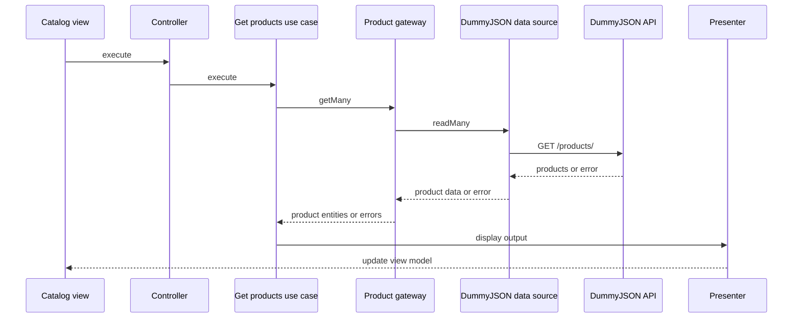

<br>
<div align="center">
    <h1>🏗️ Clean Architecture</h1>
    <strong>A clean architecture example to implement testable and evolutive systems</strong>
</div>
<br>
<br>

## ✨ Features

A TypeScript implementation of [the Clean Architecture specified by Robert C. Martin (Uncle Bob)](https://blog.cleancoder.com/uncle-bob/2012/08/13/the-clean-architecture.html).  
The Clean Architecture is an architectural pattern that enables the creation of loosely coupled and testable systems by enforcing a clear separation of concerns. This separation isolates the business rules from the details (such as frameworks and external dependencies like databases), making the system more maintainable and evolutive.

Following the ["decompose by subdomain" pattern](https://microservices.io/patterns/decomposition/decompose-by-subdomain.html), a **modular architecture** has also been implemented to encapsulate and group all concerns from presentation to data per bounded context[^1]. This modular monolith approach enables decision autonomy within a module boundary[^2] and the creation of [self-contained systems](https://scs-architecture.org/) centered around business capabilities[^3].

Furthermore, drawing inspiration from [the Vertical Slice Architecture](https://www.jimmybogard.com/vertical-slice-architecture/) and the package by [feature](https://phauer.com/2020/package-by-feature/)/[component](https://learning-notes.mistermicheels.com/architecture-design/reference-architectures/package-by-feature-or-component/) pattern, top-level directories within a module group **business features**[^3] and shared entity units.
Feature directories use a verb-based name, such as `get-products`, and contain a use case and its supporting layers.
Shared entity directories use a noun, such as `product`, and contain the entity, gateway adapters, and framework integrations.
This organization helps [communicate the application's intent](https://blog.cleancoder.com/uncle-bob/2011/09/30/Screaming-Architecture.html) and keeps business components discoverable and cohesive.
Second-level directories follow the Clean Architecture layers; lint rules check their direct dependencies.

[^1]: In this repository, a [bounded context](https://martinfowler.com/bliki/BoundedContext.html) is implemented by one module, so a bounded context is equivalent to a module here. However, it's not always the case since [a bounded context is not strictly equivalent to a module](https://stackoverflow.com/a/77923055). Indeed, while a module is a technical-oriented concept that defines logical boundaries in the code, a [bounded context](https://deviq.com/domain-driven-design/bounded-context) is a business-oriented one (domain-driven design tactical pattern) that represents a [cohesive area of the business domain](https://ddd-practitioners.com/2023/03/07/the-difference-between-domains-subdomains-and-bounded-contexts/). A module is a technical enabler to implement a bounded context, which can contain one or multiple modules.

[^2]: By its standalone nature, a module enables more easily local decisions such as which architecture makes the most sense depending on the nature of the business and its complexity. For example, a module A with no or little business logic can implement a non-layered architecture (e.g. MVC, [transaction scripts](https://martinfowler.com/eaaCatalog/transactionScript.html), ...) while a module B with more extensive and complex business rules can use a [layered-like architecture to allow better separation of concerns](https://ddd-practitioners.com/home/glossary/layered-architecture/) (e.g. Clean Architecture, Onion Architecture, ...). In the repository, we're focusing on the clean architecture. Consequently, each module implements this architecture.

[^3]: A feature represents solution functionality that delivers business value while a capability represents larger solution functionality (generally a subdomain) grouping multiple features together in a cohesive way.

<br>

## 🏗️ Architecture

### Overview

The web host displays a catalog of products retrieved from [DummyJSON](https://dummyjson.com/).
The catalog module contains the `get-products` feature and the shared `product` entity unit.
The `bookmark` module is a placeholder: the host's Bookmark button currently only logs a message.

The following diagram shows the runtime flow when the catalog view loads, not the direction of source-code dependencies:



The use case calls the gateway and presenter through interfaces owned by the inner layers.
Runtime calls can cross outward through these interfaces while source dependencies point inward.

### Modules

The application is a single package containing a web host, business modules, and shared code:

```text
clean-architecture/src/
  hosts/web/                       # React entry point and composition
  modules/
    catalog/
      index.ts                     # Module API
      get-products/
        adapters/                  # Controller, presenter, view model
        frameworks/                # React view
        use-cases/                 # Get products interactor
        index.ts                   # Feature API
      product/
        adapters/                  # Product gateway
        entities/                  # Entity and inner-facing API
        frameworks/                # Data source and gateway provider
        index.ts                   # Product unit API
    bookmark/                      # Placeholder
  shared/                          # Shared entities, primitives, design system
```

Each implemented module owns its business capability and exposes a public API through its `index.ts`.
The web host imports the catalog API; modules access other modules through their public APIs rather than their internals.
Within a module, feature and entity units expose entry points for collaboration: for example, the `get-products` use case imports the product gateway contract from `product/entities/index.ts`, while its React view uses the product unit's outer entry point.
The shared code is accessed through `shared/index.ts` and does not depend on business modules or hosts.

The intended source dependency direction is frameworks and drivers to interface adapters, then use cases, then entities.
The [Oxlint boundary rules](./oxlint.config.ts) check module and unit entry points and direct imports between categorized layers.
They do not follow dependencies through public barrels, check external framework imports, or analyze dynamically computed import paths.

#### Shared code

The [shared directory](./clean-architecture/src/shared/) contains value objects, common primitives, and a design system.
Its README describes the shared kernel concept; not everything in this directory is domain code.

### Layers


- [Enterprise business rules (entities)](./clean-architecture/src/modules/catalog/product/entities/): Define domain entities, their validation, and the gateway contracts needed to access them. The product entity uses shared value objects for identity, creation date, and price.
- [Application business rules (use cases)](./clean-architecture/src/modules/catalog/get-products/use-cases/): Coordinate application behavior through inner-owned contracts. The get-products interactor obtains products from a gateway and sends output to a presenter.
- [Interface adapters](./clean-architecture/src/modules/catalog/get-products/adapters/): Translate between use cases and external representations. The controller invokes the interactor, the presenter formats its output for the view, and the [product gateway](./clean-architecture/src/modules/catalog/product/adapters/) converts data-source records into entities.
- [Frameworks and drivers](./clean-architecture/src/modules/catalog/product/frameworks/): Integrate external technologies. The example uses a React view and provider and a DummyJSON network data source.
- [Hosts](./clean-architecture/src/hosts/): Form the outermost layer, providing entry points and composing the application. Similar to the configurator in [Hexagonal Architecture](https://alistaircockburn.com/Hexagonal%20Budapest%2023-05-18.pdf), the host includes the main component described in the Clean Architecture book. It sits on the driver side, such as a web UI, CLI, or back-end server, and wires the inner layers. The host is not depicted in the diagram above. Here, the web host renders the catalog view inside the product gateway provider; the provider constructs the gateway and data source.

### Components

Used building blocks (including [DDD tactical patterns](https://vaadin.com/blog/ddd-part-2-tactical-domain-driven-design)):

- Entities
- Value Objects
- ...

<br>

## 💬 Miscellaneous

### Onion, hexagonal, clean architecture and domain-driven design… what're the differences?

- [Hexagonal architecture](https://alistair.cockburn.us/hexagonal-architecture/) by Alistair Cockburn in 2005: it introduces a kind of plugin architecture with a ports and adapters architecture so that external and internal hexagon are not tightly coupled.
- [Onion architecture](https://jeffreypalermo.com/2008/07/the-onion-architecture-part-1/) by Jeffrey Palermo in 2008: it defines several layers within and outside the hexagon with clear responsibilities and dependency direction.
- [Clean architecture](https://blog.cleancoder.com/uncle-bob/2012/08/13/the-clean-architecture.html) by Uncle Bob in 2012: it tries to mix the best of all previous architectures with some subtle semantic differences ("domain model" becomes "entity", …). It puts use cases in the center of the application making it screamingly clear what the application does.

Though these architectures all vary in their details, they're very similar: same objective (separation of concerns) by dividing the software into layers (each has at least one layer for the business logic and other for the externals).

They're means (architecture patterns) that can be used to design concretely domain-driven system (tactical domain-driven design).

### How the number of layers can impact accidental coupling?

Uncle Bob explains it well in his book. To quote him directly:

A simpler approach that some people follow for their ports and adapters code is to have just two source code trees:

- Domain code (the "inside")
- Infrastructure code (the "outside")

This maps on nicely to the diagram (Figure 34.9) that many people use to summarize the ports and adapters architecture, and there is a compile-time dependency from the infrastructure to the domain:


This approach to organizing source code will also work, but be aware of the potential trade-off.  
It’s what I call the "Périphérique antipattern of ports and adapters". The city of Paris, France, has a ring road called the Boulevard Périphérique, which allows you to circumnavigate Paris without entering the complexities of the city.  
Having all of your infrastructure code in a single source code tree means that it’s potentially possible for infrastructure code in one area of your application (e.g., a web controller) to directly call code in another area of your application (e.g., a database repository), without navigating through the domain. This is especially true if you’ve forgotten to apply appropriate access modifiers to that code.

### Why prefer a functional programming style?

This project prefers a functional programming style, using functions and composition for consistency with common React and Vue frontend patterns.
Where practical, business rules are expressed as pure functions, with dependencies and I/O kept explicit, so they can be tested independently of the UI.
Clean Architecture does not require a particular programming paradigm, and functions can encapsulate state through closures.
Classes remain an option when an integration requires a class-based contract, such as a custom [React error boundary](https://react.dev/reference/react/Component#catching-rendering-errors-with-an-error-boundary), or a library requires an instance of a specific class.

### Could the modular monolith use separate packages?

This project keeps the hosts, shared code, and modules in one application package.
It is a modular monolith: modules organize the application by bounded context, while the application is deployed as one unit.
The [Oxlint configuration](./oxlint.config.ts) uses [eslint-plugin-boundaries](https://github.com/javierbrea/eslint-plugin-boundaries) to enforce module and slice boundaries and check direct imports against Clean Architecture's layer dependency rules.
Inner layers access another slice's entities through its `entities/index.ts`, rather than its outer-layer entry point.
These checks do not analyze dependencies hidden behind public barrels or dynamic import paths computed at runtime.

An alternative is to make the hosts, shared code, and each module separate workspace packages:

```text
hosts/web/
modules/
  catalog/
  shared/
```

Packages make dependency declarations and public entry points explicit, and `exports` restricts package-name imports to the declared API.
They also allow separate builds and dependency manifests and can support ownership boundaries within or across teams.
However, packages require more workspace configuration, relative imports can still bypass package exports, and layer dependency rules need additional checks.

Alternatives to `eslint-plugin-boundaries` for checking architecture boundaries and dependency rules include:

- [Sheriff](https://github.com/sheriff-arch/sheriff): detects barrel-based modules and checks public exports; tags and dependency rules must be configured for layer direction.
- [dependency-cruiser](https://github.com/sverweij/dependency-cruiser): checks a dependency graph against custom rules and detects cycles.
- [Fallow](https://github.com/fallow-rs/fallow): checks boundary zones and cycles alongside broader code-quality analysis; files belong to one zone, so nested boundaries need care.
- [ArchUnitTS](https://github.com/LukasNiessen/ArchUnitTS): defines dependency and cycle rules as architecture tests, run with a test framework rather than the linter.
- [Oxlint or ESLint `no-restricted-imports`](https://oxc.rs/docs/guide/usage/linter/rules/eslint/no-restricted-imports): restricts import paths, but needs per-scope patterns for architectural rules.
- [eslint-plugin-import-x](https://github.com/un-ts/eslint-plugin-import-x): provides path-resolved `no-restricted-paths` zones for forbidden dependencies.

Any option needs rules tailored to the layout and checks for aliases, relative paths, type-only imports, and dynamic imports.

<br>

## 📚 Resources

- [Clean Architecture original blog post](https://blog.cleancoder.com/uncle-bob/2012/08/13/the-clean-architecture.html).
- [Clean Architecture talk (video)](https://www.youtube.com/watch?v=Nsjsiz2A9mg).
- [Clean Architecture book summary](https://github.com/serodriguez68/clean-architecture/).
- [Domain-Driven Design tactical design and Clean Architecture (video)](https://www.youtube.com/watch?v=hf_XBb5cSoA).
- [Pull-based vs push-based approach managing use case output](https://softwareengineering.stackexchange.com/a/420360) or [why presenters (push-based) should be preferred to returned use case values (pull-based)](https://lukemorton.tech/articles/nuances-in-clean-architecture). TLDR; Communication from Controller to Presenter is meant to go through the application layer, making the Controller do part of the Presenters job is likely a domain/application leak.
- [Single responsibility principle and mixing presenter/controller](https://stackoverflow.com/questions/64415618/clean-architecture-controller-and-presenter-should-always-be-separate-classes-o). TLDR; Not mixing them allows better flexibility later if some other ways of displaying data (i.e. presenters) should be supported (Web, CLI, JSON, ...).
- [The "Real" Repository Pattern in Android](https://proandroiddev.com/the-real-repository-pattern-in-android-efba8662b754).

<br>

## ✍️ Contribution

We're open to new contributions, you can find more details [here](https://github.com/adbayb/clean-architecture/blob/main/CONTRIBUTING.md).

<br>

## 📖 License

[MIT](https://github.com/adbayb/clean-architecture/blob/main/LICENSE "License MIT")

<br>
